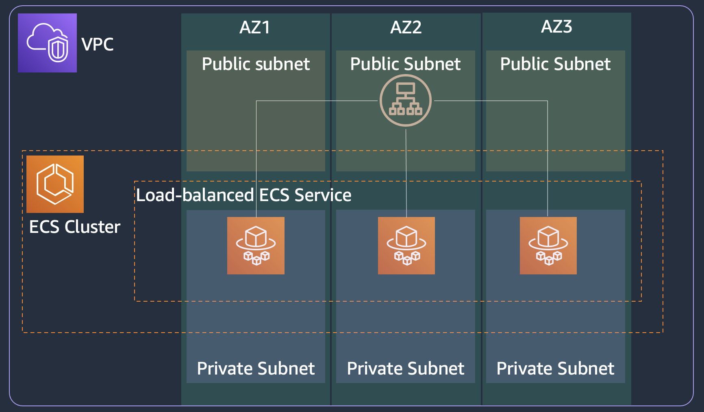

# ECS load-balanced service

This solution blueprint creates a web-facing load balanced ECS service. There are two steps to deploying this service:

* Deploy the [external-state core infrastructure](../core-infra-external-state/README.md). If you have already deployed it, you can reuse it.
* Deploy this blueprint using the below commands. This root stores its state in the
external S3 bucket created by [`../external-state-bucket`](../external-state-bucket/README.md)
and enables S3 native state locking (`use_lockfile`), which requires **Terraform >= 1.11**.
Because the root declares `backend "s3" {}` with partial configuration, a plain
`terraform init` fails; pass the state bucket, key, and region at init time:
```shell
STATE_BUCKET=$(aws ssm get-parameters --names terraform_state_bucket --region us-west-2 | jq -r '.Parameters[0].Value')
terraform init \
  -backend-config="bucket=$STATE_BUCKET" \
  -backend-config="key=lb-service-dev.tfstate" \
  -backend-config="region=us-west-2"
terraform plan -var-file=../dev.tfvars
terraform apply -var-file=../dev.tfvars -auto-approve
```

<p align="center">
  
</p>

The solution has following key components:

* ALB: We are using Application Load Balancer for this service. Note the following key attributes for ALB:
    * ALB security group - allows ingress from any IP address to port 80 and allows all egress
    * ALB subnet - ALB is created in a public subnet
    * Listener - listens on port 80 for protocol HTTP
    * Target group - Since we are using Fargate launch type, the target type is IP because each task gets its own ENI and IP address. The target group sends HTTP traffic and health checks to container port 80.
* ECR registery for the container image. We are using only one container image for the task in this example.
* ECS service definition:
    * Task security group: allows ingress for TCP from the ALB security group to container port 80 and allows all egress.
    * Service discovery: You can register the service to AWS Cloud Map registry. You just need to provide the `namespace` but make sure the namespace is created in the `core-infra` step.
    * Tasks for this service will be deployed in private subnet
    * Service definition takes the load balancer target group created above as input.
    * Task definition consisting of task vCPU size, task memory, and container information including the above created ECR repository URL.
    * Task definition also takes the task execution role ARN which is used by ECS agent to fetch ECR images and send logs to AWS CloudWatch on behalf of the task.

## Cost

This example creates billable AWS resources. Review `terraform plan`, use a sandbox account, and avoid leaving the stack deployed when it is not in use. NAT gateways, load balancers, databases, and accelerated instances are common cost drivers where present.

## Quotas

Confirm that the target Region has sufficient ECS task, elastic network interface, load balancer, and any workload-specific service quotas before deployment. EC2 examples also require available capacity for the selected instance types.

## Validation

Run `terraform fmt -check`, `terraform init` (with the `-backend-config` options above, or `-backend=false` for offline checks), `terraform validate`, and review `terraform plan` before applying. After deployment, use the functional check described above and inspect ECS service events and CloudWatch Logs for task failures.

## Cleanup

Run `terraform destroy -var-file=../dev.tfvars` from this example directory. Remove retained data or separately created secrets only after confirming they are no longer needed.
