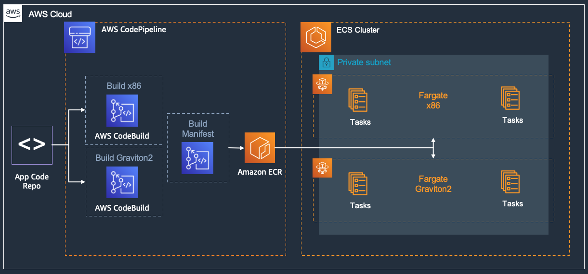
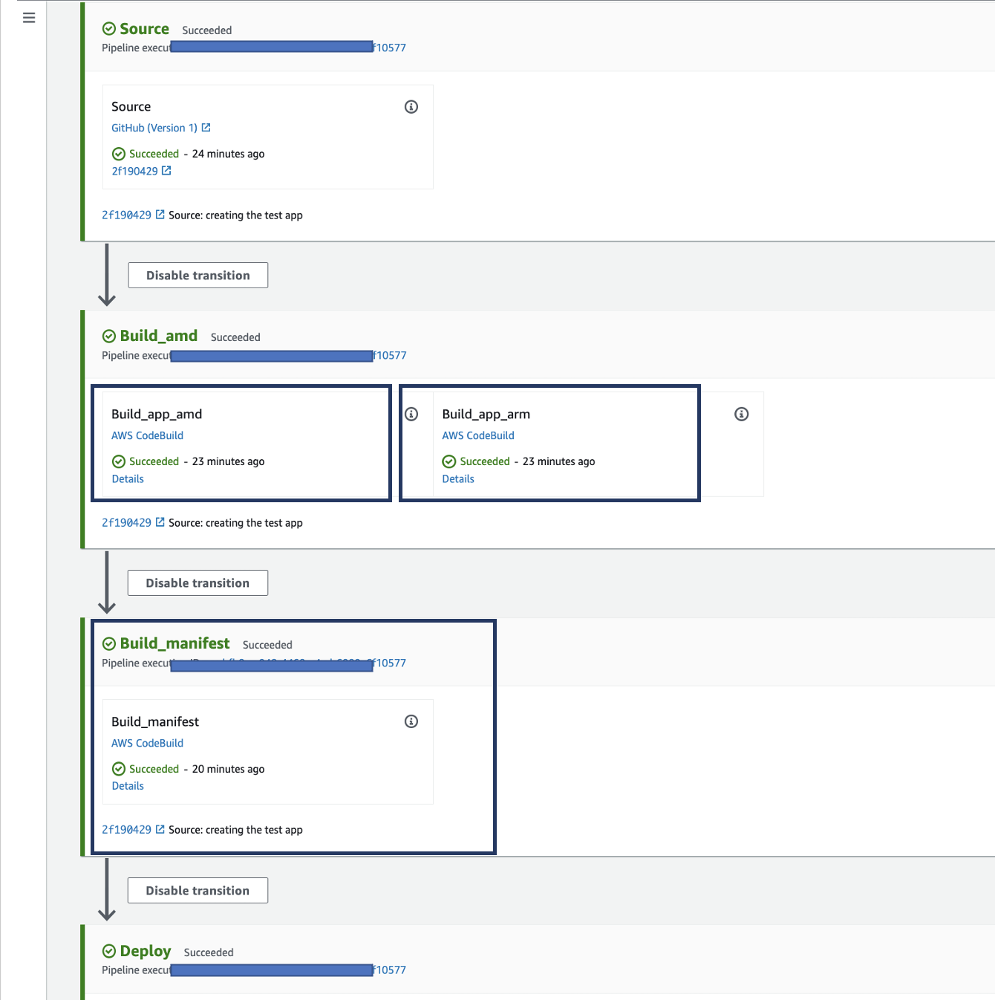
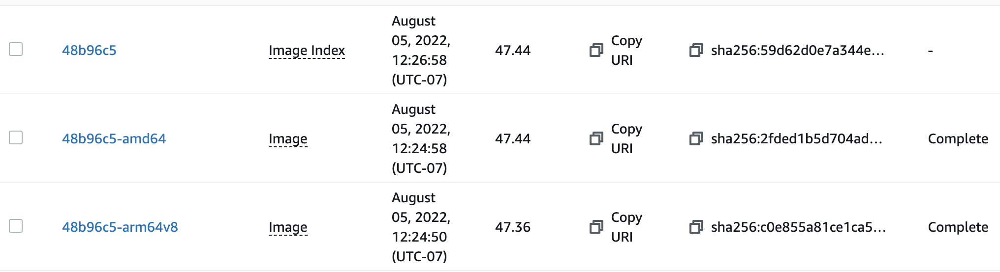

# Graviton and Multi-architecture Container Images

AWS Graviton processors are custom built by Amazon Web Services using 64-bit Arm Neoverse cores to deliver the best price performance for your cloud workloads. AWS Fargate supports Graviton enabling containerized workloads to benefit from Graviton lower price with better performance.

This solution blueprint focuses on how to build multi-architecture images, store them in ECR, and most importantly launch tasks on both Fargate x86 and ARM without juggling architecture specific container images.

This example is self-contained for its infrastructure: it creates its own VPC, ECS
cluster, Cloud Map namespace, load balancers, ECR repository, and CI/CD pipeline in one
`terraform apply`, with no separately deployed shared-infrastructure stack. Set `name` to
deploy another isolated copy in the same account and Region.

## Prerequisites

This blueprint builds its container image with a CodePipeline/CodeBuild pipeline that
pulls from **your** GitHub fork, so two things must exist before `terraform apply`:

1. A fork of this repository (the pipeline builds the app under
   `application-code/nodejs-demoapp`). Pass its owner via the required `repository_owner`
   variable (no default) and, if you renamed it, `repository_name`.
2. A GitHub personal access token stored as a **plaintext** AWS Secrets Manager secret in
   the deployment Region, named to match `github_token_secret_name` (default
   `ecs-github-token`):
   `aws secretsmanager create-secret --name ecs-github-token --secret-string "<token>"`.

Until the first pipeline run succeeds, the ECR repository is empty and the ECS services
have no image to run — this is expected. Deploy with, for example,
`terraform apply -var="repository_owner=<your-github-user>"`.

## Deployment

* Create a [Github token](https://docs.github.com/en/authentication/keeping-your-account-and-data-secure/creating-a-personal-access-token) to access the forked repository.
* Store the secret in AWS Secrets Manager in the region where you want to deploy the blueprints.

```shell
aws secretsmanager create-secret --name ecs-github-token --secret-string <your-github-access-token>
```

* **NOTE:** Codestar notification rules require a **one-time** creation of a service-linked role. Please verify one exists or create the codestar-notification service-linked role.
  * `aws iam get-role --role-name AWSServiceRoleForCodeStarNotifications`

    ```An error occurred (NoSuchEntity) when calling the GetRole operation: The role with name AWSServiceRoleForCodeStarNotifications cannot be found.```
  *  If you receive the error above, please create the service-linked role with the `aws cli` below.
  * `aws iam create-service-linked-role --aws-service-name codestar-notifications.amazonaws.com`
  * Again, once this is created, you will not have to complete these steps for the other examples.  
* Now you can deploy this blueprint
```shell
terraform init
terraform plan
terraform apply
# type repository owner name and "yes"
```

The ECR repository starts empty, so the ECS services report failed image pulls until the
first pipeline execution has built and pushed the multi-architecture image. Watch the
pipeline in the CodePipeline console; once it completes, both services become healthy.

<p align="center">
  
</p>

## Solution Details
The solution has following key components:
* AWS CodePipeline: The CodePipeline for building and storing the multi-architecture images has 2 AWS CodeBuild build projects (as shown in picture below):
    * Build_image : This has two actions, one to build amd64(x86) image and the other for arm64 image. Those images have a suffix `amd64` and `arm64v8` respectively. Both the build image actions use the same [buildspec.yml](../../../application-code/nodejs-demoapp/templates/buildspec.yml)
    * Build_manifest : This is to create a manifest file. From [docker manifest](https://docs.docker.com/engine/reference/commandline/manifest/) - A single manifest is information about an image, such as layers, size, and digest. The docker manifest command also gives users additional information such as the os and architecture an image was built for. The [build_manifest.yml](../../../application-code/nodejs-demoapp/templates/buildspec_manifest.yml) creates and pushed the manifest file. This file also copys the image url, without any architecture suffix, to update the task definition and deploy tasks for service.
<p align="center">
  
</p>

* The ECR repository looks like below with the manifest along with the image tag, and the two actual images with respective architecture tags.
 <p align="center">
  
</p>

* Two ECS services are created in the cluster owned by this example: one with x86 Fargate tasks (`<name>-amd64`) and the other with Graviton arm64 Fargate tasks (`<name>-arm64`, `runtime_platform` with `cpu_architecture = "ARM64"`). You can check the task definition that each of them have the same image `"image": "xxx.dkr.ecr.<region>.amazonaws.com/nodejs-multi-arch:14f28fe"` **without the architecture suffix**. The ECS agent running in Fargate task will leverage the manifest to fetch the right image!

Note that the CodeBuild and CodePipeline services are provisioned and configured here. However, they primarily interact with the [application-code/nodejs-demoapp/](../../../application-code/nodejs-demoapp/) repository. CodePipeline is listening for changes and checkins to that repository. And CodeBuild is using the *Dockerfile* and *templates/* files from that application folder.

## HTTPS

The two ALBs in this example listen on HTTP port 80 only, which keeps the demo free of a
domain-name prerequisite. For production use:

1. Create or import a certificate in AWS Certificate Manager (ACM) in the deployment
   Region for the domain(s) that will point at the ALBs.
2. Add an HTTPS listener on port 443 to each ALB module (`protocol = "HTTPS"`,
   `certificate_arn` set to the ACM certificate) forwarding to the existing target
   group.
3. Change each port 80 listener to a `redirect` action returning `HTTP_301` to port 443
   so plaintext requests are upgraded to TLS.

## Cost

This example creates one NAT gateway, two Application Load Balancers, six Fargate tasks
(three x86, three arm64), an ECR repository, CodePipeline/CodeBuild resources, Cloud Map
services, and CloudWatch logs. The NAT gateway and the two ALBs bill hourly while idle and
are the main cost drivers; CodeBuild bills per build minute. Review current regional
pricing and do not leave the stack running when it is not in use.

## Quotas

Confirm VPC, NAT gateway, Fargate task (both x86 and ARM64 vCPU quotas), elastic network
interface, load balancer, target group, Cloud Map, ECR, CodeBuild concurrent build, and
CodePipeline quotas in the selected Region.

## Validation

Run `terraform fmt -check`, `terraform init`, `terraform validate`, and review
`terraform plan`. After deployment, wait for the first pipeline execution to finish, then
request `application_url_amd64` and `application_url_arm64`, confirm targets are healthy in
both target groups, and inspect ECS service events and CloudWatch Logs for task failures.

## Cleanup

Run `terraform destroy` from this example directory. Networking, cluster, namespace,
services, load balancers, ECR repository, and the pipeline are owned by the same Terraform
state and are removed together. The GitHub token secret in AWS Secrets Manager was created
out of band; delete it separately once no other example uses it.
