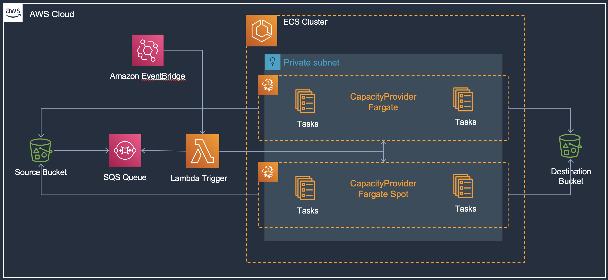

# ECS Fargate Autoscaling Queue Processing

This blueprint deploys an end to end data processing pipeline using ECS Fargate, Lambda, S3, and SQS. It is self-contained for its infrastructure — it creates its own VPC (with a single NAT gateway) and ECS cluster in one `terraform apply` and removes everything with one `terraform destroy`, with no separate `core-infra` deployment or name/tag lookups. The container image is built by the bundled CI/CD pipeline from **your** GitHub fork, so `terraform apply` requires the `repository_owner` variable (no default) and a GitHub token secret — see the setup steps below. Until the first pipeline run completes, the ECR repository is empty and tasks have no image; this is expected. This use case will process a massive number of files in S3 to be consumed or used by another job or service. For example, resizing images into a standard 224x224 or 299x299 format for deep learning.

This blueprint expects files uploaded to an S3 source bucket which trigger S3 event notifications and publish file metadata to SQS. On a regular 2 minute CloudWatch event rule, a Lambda function is invoked which checks the SQS queue for the `ApproximateNumberOfMessages` attribute and lauches Fargate tasks based on queue depth using the ECS `run_task()` API. The tasks are designed to continue processing and draining the SQS queue before scaling down to 0 tasks automatically, eliminating the need to keep a fixed pool of ECS tasks running.

* Create a [Github token](https://docs.github.com/en/authentication/keeping-your-account-and-data-secure/creating-a-personal-access-token) to access the forked repository.
* Store the secret in AWS Secrets Manager in the region where you want to deploy the blueprints.
  ```shell
  aws secretsmanager create-secret --name ecs-github-token --secret-string <your-github-access-token>
  ```
* **NOTE:** Codestar notification rules require a **one-time** creation of a service-linked role. Please verify one exists or create the codestar-notification service-linked role.
  * `aws iam get-role --role-name AWSServiceRoleForCodeStarNotifications`

    ```An error occurred (NoSuchEntity) when calling the GetRole operation: The role with name AWSServiceRoleForCodeStarNotifications cannot be found.```
  *  If you receive the error above, please create the service-linked role with the `aws cli` below.
  * `aws iam create-service-linked-role --aws-service-name codestar-notifications.amazonaws.com`
  * Again, once this is created, you will not have to complete these steps for the other examples.
* Now you can deploy this blueprint with a single apply:
```shell
terraform init
terraform plan
terraform apply -auto-approve
```
* To test, upload a lot of `.jpg` image files to the S3 source bucket
```bash
aws s3 cp . s3://ecsdemo-queue-proc-src-xx-xxx-xxx-xx/ecsproc --recursive
```
* Check the SQS queue for the notifications from the S3 bucket file upload, check CloudWatch Container Insights to see the task count increase from the Lambda run_task invocation, and check destination S3 bucket for resizes images.

**Note:** the scheduler Lambda reads a fixed set of SSM parameter names (`PIPELINE_ENABLED`, `PIPELINE_UNPROCESSED_SQS_URL`, and the other `PIPELINE_*` parameters below), so only one copy of this pattern can run per account and Region even though other resource names derive from the `name` variable.

## Blueprint Architecture

<p align="center">
  
</p>

The solutions has following key components:

* VPC with public and private subnets and a single NAT gateway; the processing tasks run in private subnets with no inbound access and reach ECR, S3, SQS, SSM, and CloudWatch through the NAT gateway
* ECS cluster with Container Insights enabled and `FARGATE`/`FARGATE_SPOT` capacity providers associated (the Lambda's `run_task()` call uses an explicit capacity provider strategy across both)
* S3 source bucket to upload the image files and S3 destination bucket where the resized images are copied.
* SQS queue which receives notifications when files are uploaded to S3 source bucket, with a dead-letter queue for messages that fail five processing attempts
* Lambda function that runs every 2 minute to check queue depth and launch Fargate tasks using ECS `run_task()` API. Lambda will launch (`ApproximateNumberofMessages`/10) upto a max of 10 tasks. These settings are configurable if you want to launch more or less tasks depending on your use case. The Lambda reads all of its settings (queue URL, cluster, task definition, subnet, security group, destination prefix) from the `PIPELINE_*` SSM parameters this blueprint creates.
* ECS Fargate task processes the image from source S3 bucket and copies to destination S3 bucket. The task is "long running" and will continue processing messages remaining in the queue. Once queue is empty the tasks will quit. This provides a built-in scale to 0.
* ECS Fargate tasks are distributed to run on a mix of Fargate on-demand and Fargate Spot instances. This provides considerable cost savings from Fargate Spot.

The rest of the components provide CI/CD pipeline to build and update the ECS Fargate image processing task.

* **Please make sure you have stored the Github access token in AWS Secrets Manager as a plain text secret (not as key-value pair secret). This token is used to access the *application-code* repository and build images.**
* S3 bucket to store CodePipeline assets. The bucket is encrypted with AWS managed key.
* 2 S3 buckets for source and destination artifacts
* SNS topic for notifications from the pipeline
* CodeBuild for building queue processing container image
    * Needs the S3 bucket created above
    * IAM role for the build service
    * The *buildspec_path* is a key variable to note. It points to the [buildspec.yml](../../../application-code/container-queue-proc/templates/buildspec.yml) file which has all the instructions not only for building the container but also for pre-build processing and post-build artifacts preparation required for deployment. The buildspec substitutes the queue name and destination bucket into the application source, so the container itself knows which queue to drain and where to copy results.
    * A set of environment variables including repository URL and folder path.
* CodePipeline to listen for changes to the repository and trigger build and deployment.
    * Needs the S3 bucket created above
    * Github token from AWS Secrets Manager to access the repository with *application-code* folder
    * Repository owner
    * Repository name
    * Repository branch
    * SNS topic for notifications created above
    * The cluster and service names for deploying the tasks with new container images
    * The image definition file name which contains mapping of container name and container image. These are the containers used in the task.
    * IAM role

Note that the CodeBuild and CodePipeline services are provisioned and configured here. However, they primarily interact with the *application-code/container-queue-proc* repository. CodePipeline is listening for changes and checkins to that repository. And CodeBuild is using the *Dockerfile* and *templates/* files from that application folder.

## Cost

This example creates billable AWS resources: a NAT gateway, Fargate tasks (up to 10,
launched on demand on a mix of on-demand and Spot), a Lambda function, an SQS queue with
DLQ, two S3 buckets, CloudWatch logs, and CodePipeline/CodeBuild resources. The NAT
gateway is the main idle cost driver; Fargate tasks bill only while the queue has
messages. Review `terraform plan`, use a sandbox account, and avoid leaving the stack
deployed when it is not in use.

## Quotas

Confirm that the target Region has sufficient VPC, NAT gateway, Fargate task (on-demand
and Spot), elastic network interface, Lambda concurrent execution, and
CodeBuild/CodePipeline service quotas before deployment. The Lambda launches up to 10
concurrent Fargate tasks during the demo.

## Validation

Run `terraform fmt -check`, `terraform init`, `terraform validate`, and review
`terraform plan` before applying. After deployment, upload `.jpg` files under the
`ecsproc/` prefix of the source bucket, confirm SQS receives the notifications, watch the
task count rise in CloudWatch Container Insights, and check the destination bucket for
resized images. Inspect ECS task stopped reasons and CloudWatch Logs for failures.

## Cleanup

Let the queue drain (or set the `PIPELINE_ENABLED` SSM parameter to `0` to stop new task
launches), then run `terraform destroy` from this example directory. Networking, cluster,
buckets, queue, Lambda, and pipeline resources are owned by the same Terraform state and
are removed together; both S3 buckets are created with `force_destroy` for demo purposes.
Remove the separately created GitHub token secret only after confirming it is no longer
needed.
