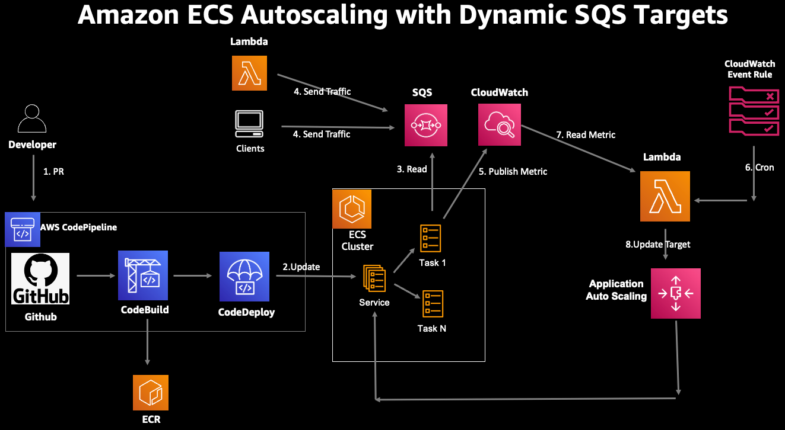
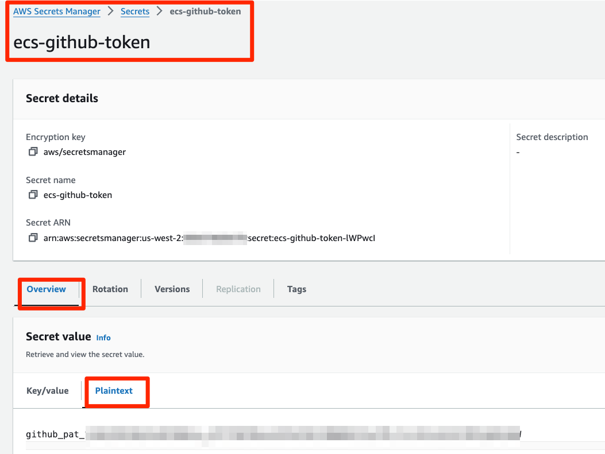
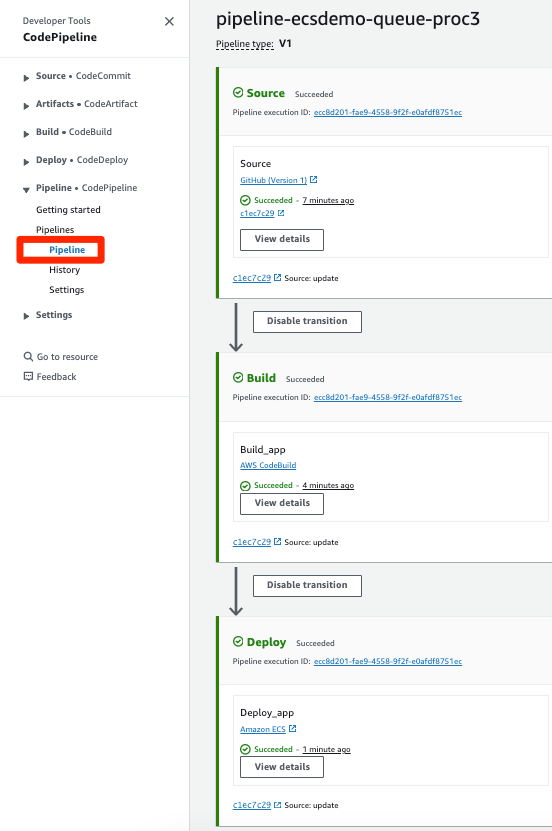
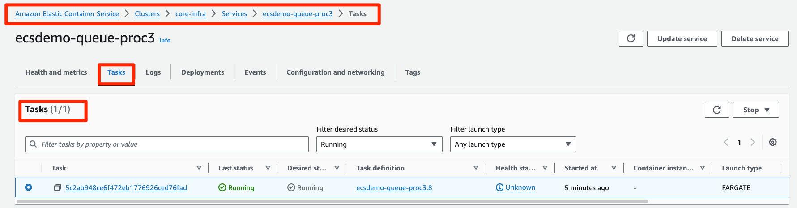
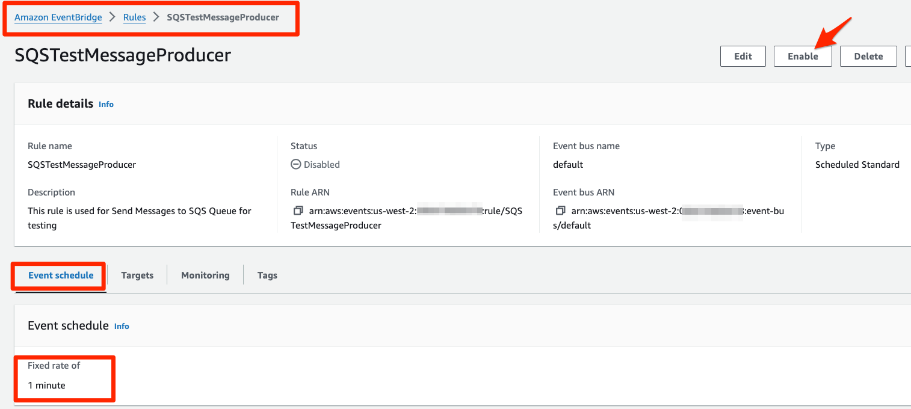
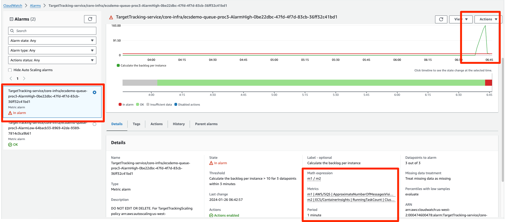
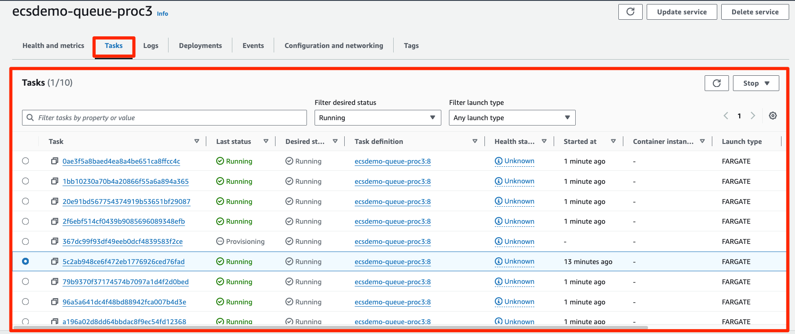

# ECS Fargate Application Autoscaling With Dynamic Target Tracking for SQS Queue Processing

## Solution Overview

This blueprint deploys an end to end queue processing pipeline using ECS Fargate, Lambda,
and SQS. It is self-contained for its infrastructure — it creates its own VPC (with a
single NAT gateway) and ECS cluster in one `terraform apply` and removes everything with
one `terraform destroy`, with no separate `core-infra` deployment or name/tag lookups.

**Prerequisites (the container image is built by a CI/CD pipeline):** this blueprint's
CodePipeline builds the worker image from **your** GitHub fork, so before `terraform apply`
you must (1) fork this repository (the app lives under
`application-code/ecsdemo-queue-proc`) and pass its owner via the required
`repository_owner` variable (no default), and (2) store a GitHub token as a plaintext AWS
Secrets Manager secret matching `github_token_secret_name` (default `ecs-github-token`):
`aws secretsmanager create-secret --name ecs-github-token --secret-string "<token>"`.
Until the first pipeline run completes, the ECR repository is empty and the service has no
image — this is expected. Deploy with, e.g.,
`terraform apply -var="repository_owner=<your-github-user>"`.

The workload has the following requirements:

1. messages come to an SQS queue on a regular interval.
2. each message processing duration varies.
3. the ECS service needs to scale to handle the messages at scale.

For latency-sensitive applications, [AWS guidance describes a common pattern](https://docs.aws.amazon.com/autoscaling/ec2/userguide/as-using-sqs-queue.html) that allows an ECS Service to scale in response to the backlog of an Amazon SQS queue while accounting for the average message processing duration (MPD) and the application’s desired latency.

This blueprint expects sample messages to be available in the SQS queue. The blueprint provisions a Lambda function which runs every minute via an EventBridge rule. This rule is disabled by default. Once the workload is ready to test, you can enable it to start sending `50` messages to the SQS queue every minute.

Every message in the SQS queue has a field to denote the message processing time in seconds. The ECS task does the following operations:

1. reads a message from the SQS queue
2. sleeps for the duration of the message processing time
3. deletes the message from the SQS queue
4. publishes a metric to CloudWatch with the value of the message processing time

The ECS service is scaled using target tracking on a custom metric. The custom metric is ecsBPI (ECS backlog per instance) and is calculated as follows.

ecsBPI = ApproximateNumberOfMessages / number of ECS tasks

The target used for ECS service target tracking is ecsTargetBPI.

ecsTargetBPI = (maximum acceptable delay) / MPD

## Solution Blueprint Architecture

<p align="center">
  
</p>

The solution has the following key components:

* VPC with public and private subnets and a single NAT gateway; the queue workers run in private subnets with no inbound access and reach ECR, SQS, and CloudWatch through the NAT gateway
* ECS cluster with Container Insights enabled (supplies the `RunningTaskCount` metric used in the scaling expression)
* Lambda function to send test messages to the SQS queue
* FIFO SQS queue which holds the messages, with a dead-letter queue for poison messages
* Lambda function that runs every hour to adjust the target for the ECS service target tracking scaling policy
* ECS service which processes messages from the SQS queue by reading each one and sleeping for its MPD
* CodePipeline to build and deploy the image to the ECS cluster

* **Please make sure you have stored the Github access token in AWS Secrets Manager as a plain text secret (not as key-value pair secret). This token is used to access the *application-code* repository and build images.**

<p align="center">
  
</p>

* Clone the repository to your local or managed development environment.
* S3 bucket to store CodePipeline assets. The bucket is encrypted with AWS managed key.
* SNS topic for notifications from the pipeline
* CodeBuild for building queue processing container image
    * Needs the S3 bucket created above
    * IAM role for the build service
    * The *buildspec_path* is a key variable to note. It points to the [buildspec.yml](../../../application-code/ecsdemo-queue-proc/templates/buildspec.yml) file which has all the instructions not only for building the container but also for pre-build processing and post-build artifacts preparation required for deployment.
    * A set of environment variables including repository URL and folder path.
* CodePipeline to listen for changes to the repository and trigger build and deployment.
    * Github token from AWS Secrets Manager to access the repository with *application-code* folder
    * Repository owner
    * Repository name
    * Repository branch
    * SNS topic for notifications created above
    * The cluster and service names for deploying the tasks with new container images
    * The image definition file name which contains mapping of container name and container image. These are the containers used in the task.
    * IAM role

## Deploy the Solution

* **NOTE:** Codestar notification rules require a **one-time** creation of a service-linked role. Please verify one exists or create the codestar-notification service-linked role.
  * `aws iam get-role --role-name AWSServiceRoleForCodeStarNotifications`
    ```An error occurred (NoSuchEntity) when calling the GetRole operation: The role with name AWSServiceRoleForCodeStarNotifications cannot be found.```
  *  If you receive the error above, please create the service-linked role with the `aws cli` below.
  * `aws iam create-service-linked-role --aws-service-name codestar-notifications.amazonaws.com`
  * Again, once this is created, you will not have to complete these steps for the other examples.
* Now you can deploy this blueprint with a single apply:
```shell
terraform init
terraform plan
terraform apply
```

Set `name` to deploy another isolated copy in the same account and Region.

## Test the Solution

* Do a simple dummy change in your Github repo and push the change to start the CodePipeline to build the application container image and push to ECS Service. Note that the CodeBuild and CodePipeline services are provisioned and configured here. However, they primarily interact with the *application-code/ecsdemo-queue-proc* repository. CodePipeline is listening for changes and checkins to that repository. And CodeBuild is using the *Dockerfile* and *templates/* files from that application folder.
* Ensure that CodePipeline is running successful

<p align="center">
  
</p>
* Initally there will be one ECS task in the ECS Service

<p align="center">
  
</p>
* To start sending messages to the SQS queue for testing, go to the EventBridge console and enable the rule `<name>-message-producer` (with the default `name` variable, `ecsdemo-queue-message-producer`). It sends 50 test messages per minute.

<p align="center">
  
</p>

* The Application will start processing messages from SQS Queue and will emit a CloudWatch metric `MsgProcessingDuration`

* The Alarm for the Application Autoscaling Policy based on Target Tracking using Custom CloudWatch Metrcs Expreession, trigers the ECS Service Autoscaling
<p align="center">
  
</p>

* The ECS Service is Autoscaled based on the Application Autoscaling using the Target Tracking Policy
<p align="center">
  
</p>

* Watch the service scale in the ECS console (task count grows toward the 10-task maximum while the backlog per task exceeds the target, and shrinks back to 1 after you disable the rule and the queue drains). The `<name>-target-bpi-update` rule (disabled by default) can be enabled to let the second Lambda re-derive the scaling target from observed processing durations every hour.

## Cost

This example creates billable AWS resources: a NAT gateway, Fargate tasks (1 to 10 with
autoscaling), two Lambda functions, an SQS FIFO queue with DLQ, CloudWatch logs and
metrics, and CodePipeline/CodeBuild resources. The NAT gateway and running Fargate tasks
are the main cost drivers. Review `terraform plan`, use a sandbox account, and avoid
leaving the stack deployed when it is not in use.

## Quotas

Confirm that the target Region has sufficient VPC, NAT gateway, Fargate task, elastic
network interface, Lambda concurrent execution, and CodeBuild/CodePipeline service quotas
before deployment. The service scales up to 10 concurrent Fargate tasks during the demo.

## Validation

Run `terraform fmt -check`, `terraform init`, `terraform validate`, and review
`terraform plan` before applying. After deployment, enable the message producer rule,
confirm the queue depth and `MsgProcessingDuration` metric in CloudWatch, and watch the
ECS service scale out. Inspect ECS service events and CloudWatch Logs for task failures.

## Cleanup

Disable the EventBridge rules and let the queue drain, then run `terraform destroy` from
this example directory. Networking, cluster, service, queues, Lambdas, and pipeline
resources are owned by the same Terraform state and are removed together. Remove the
separately created GitHub token secret only after confirming it is no longer needed.
